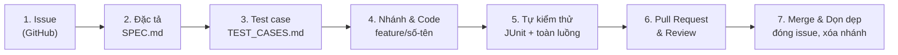

# QUY TRÌNH PHÁT TRIỂN MỘT FEATURE - SALTAIR
> **Áp dụng cho:** mọi chức năng mới, sửa giao diện, sửa logic trong dự án Saltair (JAV102).
> **Mục tiêu:** ai nhận việc cũng làm theo cùng một đường, tài liệu đi kèm code, người sau đọc lại là hiểu, dự án thêm người hay thêm chức năng vẫn không rối.
> **Ngữ cảnh chung của dự án:** [`project.md`](../project.md) (nghiệp vụ, kiến trúc, quy ước). File này chỉ nói về **cách làm** một feature.

---

## 📌 PHẦN I. SƠ ĐỒ LUỒNG THỰC HIỆN (FLOW)



Mỗi bước có **sản phẩm nghiệm thu** riêng. Chưa đạt nghiệm thu của bước trước thì không sang bước sau.

---

## 📅 PHẦN II. BẢNG TÓM TẮT 7 BƯỚC & SẢN PHẨM NGHIỆM THU

| Bước | Ai làm | Việc chính | Sản phẩm nghiệm thu |
| :---: | :--- | :--- | :--- |
| **1. Issue** | Trưởng nhóm (hoặc người đề xuất) | Tạo issue từ mẫu **[Logic]** hoặc **[Giao diện]**, gắn nhãn, giao người. | Issue có đủ: Mô tả, Cần làm, Nghiệm thu, nhãn `logic`/`giao-dien` + mảng (`auth`, `cart`...). |
| **2. Đặc tả** | Người nhận issue | Copy `docs/features/_TEMPLATE/` thành `docs/features/<số>-<tên>/`, điền `SPEC.md`. | `SPEC.md` có quy tắc nghiệp vụ, endpoint, DB, giao diện, trường hợp lỗi. |
| **3. Test case** | Người nhận issue | Từ `SPEC.md` viết bảng ca kiểm thử (dùng AI hỗ trợ được). | `TEST_CASES.md` có ít nhất 1 ca Positive và các ca Negative cho từng quy tắc. |
| **4. Nhánh & Code** | Người nhận issue | Tách nhánh từ `develop`, code theo luồng `Servlet -> Service -> Repository`. | Code biên dịch được, commit đúng mẫu `feat(scope): ...`. |
| **5. Tự kiểm thử** | Người nhận issue | Chạy JUnit, chạy theo `TEST_CASES.md`, điền cột Trạng thái. | Mọi ca đều **Pass**, `mvn test` xanh, ghi `AI_LOG.md` nếu có dùng AI. |
| **6. Pull Request** | Người nhận issue → Trưởng nhóm review | Mở PR vào `develop` theo mẫu, ghi `Closes #<số>`. | PR đủ mục, checklist tích hết, người review duyệt. |
| **7. Merge & Dọn dẹp** | Trưởng nhóm | Merge, kiểm tra issue tự đóng, nhánh tự xóa, cập nhật bảng ở `docs/features/README.md`. | `develop` chạy được, issue **Closed**, feature có dòng trong bảng tổng hợp. |

---

## 🚀 PHẦN III. HƯỚNG DẪN CHI TIẾT TỪNG BƯỚC (STEP-BY-STEP)

### 🟢 BƯỚC 1: TẠO ISSUE

#### 1. Các bước thực hiện
* **1.1** Trên GitHub chọn **Issues → New issue**, chọn mẫu:
  * **[Logic]**: Servlet, Service, Repository, database, cấu hình.
  * **[Giao diện]**: JSP, CSS, JS, hiệu ứng.
  * Một chức năng có cả hai phần thì tạo **2 issue** và ghi chéo `Đi cùng: #<số>` (ví dụ #74 logic đăng nhập bằng mã và #75 giao diện khung tài khoản).
* **1.2** Gắn nhãn: loại (`logic`/`giao-dien`), mảng (`auth`, `account`, `shop`, `cart`, `order`, `admin`), người nhận (`nguoi-X`). Việc chưa chốt được thì thêm `can-quyet-dinh`.
* **1.3** Viết mục **Nghiệm thu** thành danh sách `- [ ]` đo được (bấm gì, thấy gì). Không viết kiểu "chạy ổn", "đẹp".

#### 2. Tiêu chí nghiệm thu Bước 1
- [ ] Issue dùng đúng mẫu, đủ 3 mục: Mô tả, Cần làm, Nghiệm thu.
- [ ] Có nhãn loại, nhãn mảng, người nhận.
- [ ] Không còn nhãn `can-quyet-dinh` trước khi bắt đầu code.

---

### 🟢 BƯỚC 2: VIẾT ĐẶC TẢ `SPEC.md`

#### 1. Các bước thực hiện
* **2.1** Tạo thư mục feature từ mẫu:
  ```bash
  cp -R docs/features/_TEMPLATE docs/features/<số-issue>-<ten-ngan>
  ```
  Tên thư mục viết thường, không dấu, nối bằng gạch ngang. Ví dụ: `docs/features/74-dang-nhap-bang-ma/`.
* **2.2** Điền `SPEC.md`:
  * **Quy tắc nghiệp vụ**: từng quy tắc một dòng, có con số cụ thể (15 phút, sai 5 lần, 60 giây...).
  * **Endpoint**: phương thức, đường dẫn, tham số, kết quả thành công, kết quả lỗi.
  * **Thay đổi database**: bảng, cột, file migration. Không đổi thì ghi "Không".
  * **Giao diện**: trang nào, trạng thái nào (trống, đang tải, lỗi, thành công).
  * **Ngoài phạm vi**: những gì cố ý không làm, để người review không hỏi lại.
* **2.3** Quyết định nào chưa chắc thì hỏi trưởng nhóm, ghi kết quả vào mục **Quyết định đã chốt** kèm ngày.

#### 2. Tiêu chí nghiệm thu Bước 2
- [ ] Có thư mục `docs/features/<số>-<tên>/` với `SPEC.md` đã điền, không còn chữ `[...]` của mẫu.
- [ ] Mỗi quy tắc nghiệp vụ có con số hoặc điều kiện kiểm tra được.
- [ ] Có mục Ngoài phạm vi và Quyết định đã chốt.

---

### 🟢 BƯỚC 3: THIẾT KẾ TEST CASE `TEST_CASES.md` (CÓ THỂ DÙNG AI)

#### 1. Các bước thực hiện
* **3.1** Gửi `SPEC.md` cho AI (Claude, ChatGPT, Gemini) với prompt mẫu:
  > *"Bạn là QA Lead. Dưới đây là đặc tả một chức năng của website bán quần áo Saltair (Java Servlet/JSP, MySQL): [dán SPEC.md]. Hãy dùng Phân vùng tương đương và Phân tích giá trị biên để viết bảng test case theo các cột: ID, Chức năng, Mô tả, Loại (Positive/Negative), Các bước, Dữ liệu, Kết quả mong đợi. Mã ID dạng TC_<MẢNG>_<số>."*
* **3.2** Đọc lại kết quả của AI, **sửa cho đúng với code và dữ liệu mẫu thật** (`database/data.sql`): tài khoản demo, mã voucher, slug sản phẩm.
* **3.3** Dán bảng vào `TEST_CASES.md`, để cột **Trạng thái** trống (điền ở Bước 5).
* **3.4** Ghi prompt, kết quả gốc và những chỗ đã sửa vào `AI_LOG.md` (xem Phần V).

#### 2. Tiêu chí nghiệm thu Bước 3
- [ ] Mỗi quy tắc trong `SPEC.md` có ít nhất 1 ca kiểm thử.
- [ ] Có cả ca Positive và Negative; có ca giá trị biên khi quy tắc có con số.
- [ ] Dữ liệu kiểm thử là dữ liệu có thật trong `data.sql` hoặc ghi rõ cách tạo.

---

### 🟢 BƯỚC 4: TẠO NHÁNH & VIẾT CODE

#### 1. Các bước thực hiện
* **4.1** Luôn tách nhánh từ `develop` mới nhất:
  ```bash
  git checkout develop
  git pull origin develop
  git checkout -b feature/<số-issue>-<ten-ngan>
  ```
  | Loại việc | Tên nhánh | Ví dụ |
  | :--- | :--- | :--- |
  | Chức năng / giao diện | `feature/<số>-<tên>` | `feature/74-email-login` |
  | Sửa lỗi | `fix/<số>-<tên>` | `fix/92-gio-hang-am` |
  | Tài liệu | `docs/<tên>` | `docs/quy-trinh-feature` |
* **4.2** Code theo đúng tầng (xem `project.md` → Cấu trúc package):
  * `controller/<mảng>/XxxServlet`: đọc tham số, gọi Service, chọn JSP hoặc redirect. **Không** viết SQL.
  * `service/<mảng>/XxxService`: nghiệp vụ, kiểm tra dữ liệu, ném `ValidationException` với thông báo tiếng Việt.
  * `repository/<mảng>/XxxRepository`: chỉ SQL, luôn `PreparedStatement`.
  * JSP: chỉ hiển thị. Đầu file JSP ghi comment: route, các thuộc tính request, các form.
* **4.3** Đổi database thì sửa **cả 3 chỗ**: `database/schema.sql`, `database/data.sql` (nếu dữ liệu mẫu đổi) và tạo `database/migration_<số thứ tự>_<tên>.sql` cho máy đã có DB.
* **4.4** Commit nhỏ, đúng mẫu:
  ```
  <loại>(<mảng>): <việc đã làm> (#<số-issue>)
  ```
  Loại: `feat` (chức năng), `fix` (sửa lỗi), `refactor`, `test`, `docs`, `chore`, `content`. Ví dụ: `feat(auth): đăng nhập bằng email + mã 6 số (#74)`.

#### 2. Tiêu chí nghiệm thu Bước 4
- [ ] Nhánh đặt tên đúng mẫu, tách từ `develop` mới nhất.
- [ ] Không có Servlet gọi thẳng Repository, không có SQL nối chuỗi.
- [ ] Không commit `db.properties`, `mail.properties`, `cloudinary.properties`, `target/`, mật khẩu, khóa API.
- [ ] Có migration nếu đổi `schema.sql`.

---

### 🟢 BƯỚC 5: TỰ KIỂM THỬ

#### 1. Các bước thực hiện
* **5.1 Unit test (JUnit 5):** viết test cho Service có nghiệp vụ trong `src/test/java/com/fashionweb/<tầng>/<mảng>/`, ưu tiên:
  * `@ParameterizedTest` + `@CsvSource` cho giá trị biên (độ dài, số tiền, số lần).
  * `assertThrows(ValidationException.class, ...)` cho lỗi nghiệp vụ.
  ```bash
  mvn test
  ```
* **5.2 Chạy theo `TEST_CASES.md`:** khởi động Tomcat, làm lần lượt từng ca, điền **Pass/Fail** vào cột Trạng thái. Ca nào Fail thì sửa code rồi chạy lại cả bảng.
* **5.3 Kiểm tra toàn luồng:** đăng nhập khách, xem sản phẩm, thêm giỏ, đặt hàng, đăng nhập admin. Feature mới không được làm hỏng luồng cũ.
* **5.4 Giao diện:** thử ở khổ máy tính (1440px) và điện thoại (375px), xem Console trình duyệt không có lỗi đỏ.
* **5.5** Dùng AI để gỡ lỗi (dán stack trace, log Tomcat) thì ghi lại vào `AI_LOG.md`.

#### 2. Tiêu chí nghiệm thu Bước 5
- [ ] `mvn test`: **BUILD SUCCESS**, 0 Failure, 0 Error.
- [ ] Cột Trạng thái trong `TEST_CASES.md` đều là **Pass**.
- [ ] Log Tomcat không có `SEVERE` hay `Exception` mới.
- [ ] Giao diện đúng ở cả hai khổ màn hình (nếu có sửa giao diện).

---

### 🟢 BƯỚC 6: MỞ PULL REQUEST & REVIEW

#### 1. Các bước thực hiện
* **6.1** Cập nhật `develop` vào nhánh rồi đẩy lên:
  ```bash
  git pull origin develop
  git push -u origin feature/<số>-<tên>
  ```
* **6.2** Mở PR **vào `develop`** (không vào `main`). Mẫu PR tự hiện, điền đủ:
  * `Closes #<số>` để issue tự đóng khi merge.
  * Đường dẫn tới thư mục `docs/features/<số>-<tên>/`.
  * Cách kiểm tra: tài khoản, các bước bấm, kết quả mong đợi.
  * Thay đổi DB/cấu hình và lệnh người khác phải chạy sau khi pull.
  * Ảnh chụp nếu có sửa giao diện.
* **6.3** Người review đọc `SPEC.md` trước, sau đó đọc code, rồi chạy thử vài ca trong `TEST_CASES.md`. Góp ý bằng comment trên dòng code.
* **6.4** Sửa theo góp ý bằng commit mới trên cùng nhánh (không mở PR mới).

#### 2. Tiêu chí nghiệm thu Bước 6
- [ ] PR vào `develop`, có `Closes #<số>`, checklist trong mẫu PR đã tích hết.
- [ ] Không còn conflict với `develop`.
- [ ] Trưởng nhóm đã duyệt (Approve).

---

### 🟢 BƯỚC 7: MERGE & DỌN DẸP

#### 1. Các bước thực hiện
* **7.1** Trưởng nhóm merge bằng **Create a merge commit** (giữ lịch sử commit, tránh conflict giả khi các nhánh lồng nhau như #73 → #74 → #75).
  > ⚠️ Không dùng **Squash and merge** khi có nhánh khác đã tách ra từ nhánh này. Squash làm mất lịch sử, các PR còn lại sẽ báo conflict dù code đã có trong `develop`.
* **7.2** Kiểm tra: issue đã **Closed**, nhánh đã tự xóa (repo đã bật tự xóa nhánh khi merge).
* **7.3** Thêm một dòng vào bảng trong [`docs/features/README.md`](features/README.md).
* **7.4** Mọi người cập nhật máy mình:
  ```bash
  git checkout develop
  git pull origin develop
  ```
  Nếu PR có migration: chạy `mysql -u root -p saltair < database/migration_<...>.sql`.

#### 2. Tiêu chí nghiệm thu Bước 7
- [ ] Issue Closed, nhánh đã xóa trên GitHub.
- [ ] `develop` build và chạy được sau khi merge.
- [ ] Feature có dòng trong bảng tổng hợp.

---

## 📁 PHẦN IV. CẤU TRÚC THƯ MỤC TÀI LIỆU

```text
saltair-fashion-web/
├── project.md                          # Ngữ cảnh chung: nghiệp vụ, kiến trúc, quy ước
├── .github/
│   ├── ISSUE_TEMPLATE/
│   │   ├── logic.md                    # [Bước 1] Mẫu issue logic
│   │   └── giao-dien.md                # [Bước 1] Mẫu issue giao diện
│   └── pull_request_template.md        # [Bước 6] Mẫu PR
├── docs/
│   ├── QUY_TRINH_PHAT_TRIEN_FEATURE.md # File này
│   ├── TEST_PLAN.md                    # Kế hoạch kiểm thử chung của dự án
│   └── features/
│       ├── README.md                   # [Bước 7] Bảng tổng hợp các feature
│       ├── _TEMPLATE/                  # Mẫu, copy khi bắt đầu feature mới
│       │   ├── SPEC.md                 # [Bước 2] Đặc tả
│       │   ├── TEST_CASES.md           # [Bước 3, 5] Ca kiểm thử
│       │   └── AI_LOG.md               # [Bước 3, 5] Nhật ký dùng AI
│       └── 74-dang-nhap-bang-ma/       # Ví dụ đã điền đầy đủ
├── database/
│   ├── schema.sql  data.sql
│   └── migration_<số>_<tên>.sql        # [Bước 4] Mỗi lần đổi DB
└── src/test/java/com/fashionweb/       # [Bước 5] Unit test JUnit 5
```

---

## 🤖 PHẦN V. GHI NHẬT KÝ DÙNG AI (`AI_LOG.md`)

Dùng AI ở bước nào thì ghi ở bước đó, theo đúng 4 mục trong `_TEMPLATE/AI_LOG.md`:

1. **Ngữ cảnh & mục tiêu**: cần AI làm gì, cho phần nào.
2. **Prompt đã gửi**: chép nguyên văn.
3. **Kết quả AI trả về**: tóm tắt hoặc dán phần chính.
4. **Chỉnh sửa của người làm & lý do**: AI sai chỗ nào, thiếu gì, mình đã sửa thế nào.

Mục 4 là quan trọng nhất: nó cho thấy người làm hiểu code chứ không chép lại.
**Không** dán mật khẩu, khóa API, nội dung `*.properties` vào prompt hay vào nhật ký.

---

## 🎯 PHẦN VI. MỨC HOÀN THÀNH CỦA MỘT FEATURE (DEFINITION OF DONE)

| Mức | Yêu cầu | Chi tiết |
| :---: | :--- | :--- |
| **A - Hoàn chỉnh** | **Bước 1 đến 7** | Có đủ `SPEC.md`, `TEST_CASES.md` (tất cả Pass), `AI_LOG.md` (nếu có dùng AI), có unit test cho nghiệp vụ, PR đủ mục, đã merge và cập nhật bảng tổng hợp. |
| **B - Đạt** | **Bước 1, 2, 4, 5, 6, 7** | Code chạy đúng, có `SPEC.md` và đã tự kiểm thử, nhưng `TEST_CASES.md` sơ sài hoặc chưa có unit test. |
| **C - Tạm** | **Bước 1, 4, 6** | Có issue và PR, code chạy, nhưng không có tài liệu feature. Chỉ chấp nhận cho việc rất nhỏ (sửa chữ, đổi màu). |
| **D - Chưa đạt** | Thiếu issue hoặc PR | Đẩy thẳng lên `develop`/`main`, không có issue. **Không merge**, làm lại theo quy trình. |
