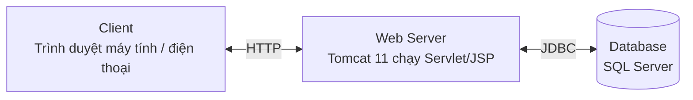
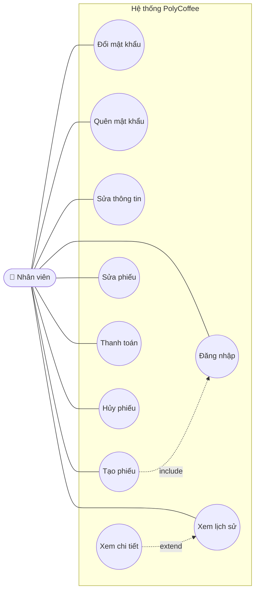
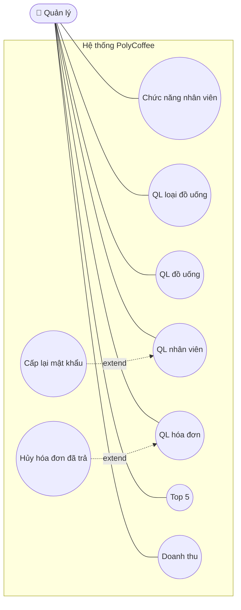

# Lab 1 - Phân tích yêu cầu và sơ đồ Use Case

Nguồn: yêu cầu khách hàng trong slide 1. File sơ đồ: [diagrams/Lab1.drawio](diagrams/Lab1.drawio) (mở bằng draw.io, gồm 3 trang).

## Bài 1. Phạm vi chức năng (Functional Requirements)

| Mã | Tác nhân | Yêu cầu chức năng |
|---|---|---|
| FR-01 | Khách hàng | Xem đồ uống ở trang chủ, gồm hình ảnh và giá |
| FR-02 | Nhân viên, Quản lý | Đăng nhập (bắt buộc trước khi dùng hệ thống), đăng xuất |
| FR-03 | Nhân viên, Quản lý | Đổi mật khẩu |
| FR-04 | Nhân viên, Quản lý | Quên mật khẩu: nhận mật khẩu mới qua email |
| FR-05 | Nhân viên, Quản lý | Sửa thông tin cá nhân |
| FR-06 | Nhân viên | Tạo phiếu bán hàng: thêm đồ uống và số lượng |
| FR-07 | Nhân viên | Sửa phiếu chưa thanh toán: thêm, bớt, xóa món |
| FR-08 | Nhân viên | Thanh toán (đóng phiếu) hoặc hủy phiếu |
| FR-09 | Nhân viên | Xem danh sách và chi tiết phiếu do mình tạo, theo thời gian |
| FR-10 | Quản lý | Thực hiện mọi chức năng của nhân viên |
| FR-11 | Quản lý | Quản lý loại đồ uống: thêm, sửa, xóa (chỉ loại chưa dùng), xem |
| FR-12 | Quản lý | Quản lý đồ uống: thêm, sửa, xóa (chỉ đồ uống chưa bán), tìm kiếm, phân trang |
| FR-13 | Quản lý | Quản lý nhân viên: thêm, sửa, khóa, tìm kiếm, cấp lại mật khẩu |
| FR-14 | Quản lý | Quản lý hóa đơn: danh sách, chi tiết, cập nhật trạng thái (hủy) |
| FR-15 | Quản lý | Thống kê doanh thu theo khoảng thời gian |
| FR-16 | Quản lý | Thống kê đồ uống bán chạy theo khoảng thời gian |

**Yêu cầu phi chức năng:** web dùng được trên máy tính và điện thoại, giao diện dễ dùng; Servlet/JSP, JDBC, SQL Server; mật khẩu được băm.

> Về xóa nhân viên: slide 1 ghi "chỉ xóa nhân viên chưa có dữ liệu", còn slide 5 ghi "chỉ cập nhật trạng thái, không được xóa tài khoản". Dự án làm theo slide 5 vì chi tiết và mới hơn.

## Bài 2. Mô hình triển khai (3 thành phần)

## Bài 3. Use case của Nhân viên
| Mã | Use case | Mô tả ngắn |
|---|---|---|
| UC-01 | Đăng nhập | Xác nhận tài khoản hợp lệ |
| UC-02 | Đổi mật khẩu | Thay mật khẩu cũ bằng mật khẩu mới |
| UC-03 | Quên mật khẩu | Lấy lại quyền truy cập qua email |
| UC-04 | Sửa thông tin cá nhân | Sửa họ tên, số điện thoại |
| UC-05 | Tạo phiếu bán hàng | «include» Đăng nhập |
| UC-06 | Sửa phiếu chưa thanh toán | Thêm món, đổi số lượng, xóa món |
| UC-07 | Thanh toán | Đóng phiếu |
| UC-08 | Hủy phiếu chưa thanh toán | |
| UC-09 | Xem lịch sử phiếu của mình | Lọc theo thời gian |
| UC-10 | Xem chi tiết phiếu | «extend» UC-09 |

## Bài 4. Use case của Quản lý
| Mã | Use case | Mô tả ngắn |
|---|---|---|
| UC-11 | Mọi chức năng của nhân viên | UC-01 đến UC-10 |
| UC-12 | Quản lý loại đồ uống | CRUD |
| UC-13 | Quản lý đồ uống | CRUD, tìm kiếm, phân trang |
| UC-14 | Quản lý nhân viên | Thêm, sửa, khóa, tìm kiếm |
| UC-15 | Cấp lại mật khẩu nhân viên | «extend» UC-14 |
| UC-16 | Quản lý hóa đơn | Danh sách, chi tiết |
| UC-17 | Hủy hóa đơn đã thanh toán | «extend» UC-16 |
| UC-18 | Thống kê top 5 bán chạy | Theo thời gian |
| UC-19 | Thống kê doanh thu | Theo thời gian, có biểu đồ |

## Bài 5
Đề ghi "Giảng viên cho thêm", chưa có nội dung.
