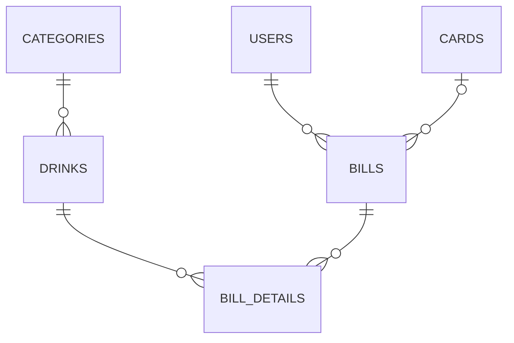
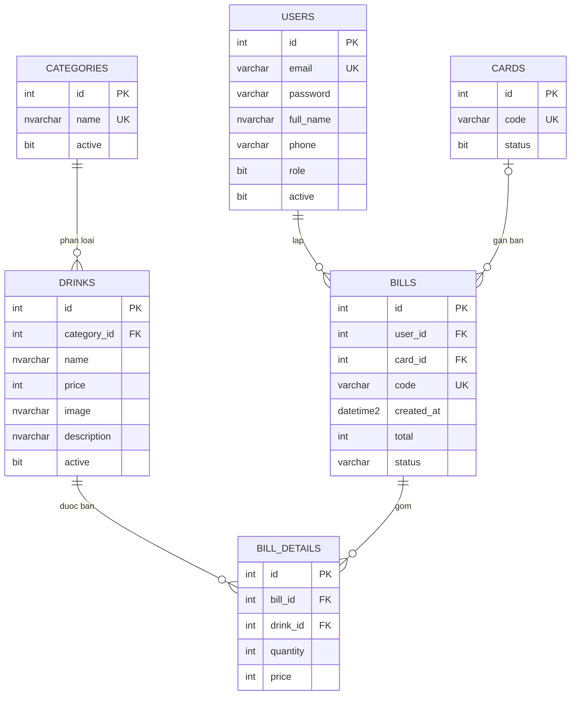
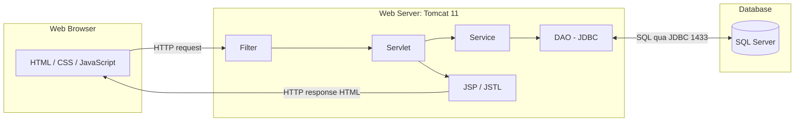
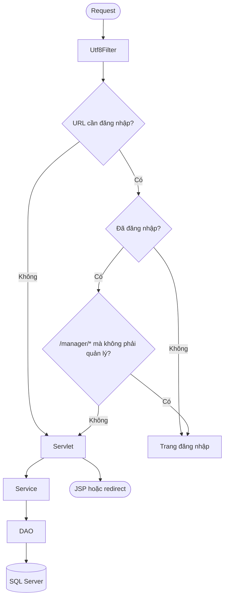

# Lab 2 - ERD và mô hình hệ thống

File sơ đồ: [diagrams/Lab2.drawio](diagrams/Lab2.drawio) (4 trang: ERD Level 1, ERD Level 2, triển khai, lưu đồ).

## Bài 1. Entity và Relationship

### 1.1 - 1.2. Entity và thuộc tính
Đề yêu cầu mỗi entity 5-7 thuộc tính, còn slide 3 chỉ định nghĩa 3 cột cho loại đồ uống. Bảng dưới là bản **phân tích**; thuộc tính có dấu (*) là đề xuất mở rộng, **chưa đưa vào CSDL** để bám đúng slide 3.

| Entity | Thuộc tính |
|---|---|
| Category | id, name, active, description (*), created_at (*) |
| Drink | id, category_id, name, price, image, description, active |
| User | id, email, password, full_name, phone, role, active |
| Bill | id, user_id, card_id, code, created_at, total, status |
| BillDetail | id, bill_id, drink_id, quantity, price |
| Card | id, code, status, position (*), note (*) |

### 1.3 - 1.4. Quan hệ và biện luận
| Quan hệ | Loại | Vì sao |
|---|---|---|
| Category - Drink | 1-N | Một loại có nhiều đồ uống; mỗi đồ uống thuộc đúng một loại để lọc và quản lý thực đơn |
| User - Bill | 1-N | Một nhân viên lập nhiều hóa đơn; mỗi hóa đơn cần đúng một người chịu trách nhiệm |
| Bill - Drink | N-N | Một hóa đơn có nhiều đồ uống và một đồ uống nằm trong nhiều hóa đơn nên phải tách bảng `bill_details` |
| Bill - BillDetail | 1-N | Mỗi dòng chi tiết chỉ thuộc một hóa đơn; xóa hóa đơn thì xóa dòng chi tiết |
| Drink - BillDetail | 1-N | Mỗi dòng chi tiết nói về đúng một đồ uống |
| Card - Bill | 1-(0..N) | Một thẻ bàn dùng cho nhiều hóa đơn theo thời gian; đơn mang đi không cần thẻ |

Không có quan hệ 1-1 vì không thực thể nào cần tách đôi thông tin.

## Bài 2. ERD

### Level 1

### Level 2

## Bài 3. Dùng AI phân tích ERD

> **Ghi rõ:** đề yêu cầu dùng ChatGPT. Phần rà soát dưới đây được thực hiện bằng **Claude (Claude Code)**. Nếu giảng viên bắt buộc dùng ChatGPT, cần tự gửi lại prompt này và thay kết quả.

**Prompt (theo mẫu ROLE - CONTEXT - OBJECTIVE - OUTPUT - CONSTRAINTS của slide 2):**
> Bạn đóng vai Business Analyst cấp Senior. Bối cảnh: hệ thống bán hàng quán PolyCoffee. Hãy phân tích ERD sau (categories, drinks, users, cards, bills, bill_details theo mô tả của slide 3) và cho biết có lỗi thiết kế gì không. Đầu ra: danh sách lỗi và cách sửa, chuẩn SQL Server.

**Điểm cần sửa và cách đã sửa trong [`database/polycoffee.sql`](../../database/polycoffee.sql):**

| # | Vấn đề ở bản phác thảo | Hậu quả | Đã sửa |
|---|---|---|---|
| 1 | Email, tên loại, mã hóa đơn, mã thẻ không bắt buộc duy nhất | Trùng tài khoản, trùng mã | Thêm `UNIQUE` |
| 2 | Một hóa đơn có thể có hai dòng cùng một đồ uống | Tăng/giảm số lượng không biết sửa dòng nào | `UNIQUE(bill_id, drink_id)` |
| 3 | Nếu `bill_details` không lưu giá riêng | Đổi giá làm sai hóa đơn cũ | Lưu `price` tại thời điểm bán |
| 4 | `status` là chuỗi tự do | Dữ liệu rác như "done", "xong" | `CHECK status IN ('waiting','finish','cancel')` |
| 5 | Số lượng, giá, tổng không có giới hạn | Số âm làm sai doanh thu | `CHECK` cho quantity, price, total |
| 6 | `card_id` bắt buộc | Không lập được đơn mang đi | Cho phép `NULL` |
| 7 | Truy vấn hóa đơn theo nhân viên và ngày không có index | Chậm khi nhiều dữ liệu | Thêm 2 index trên `bills` |

**Báo cáo: AI đã giúp cải thiện thế nào?**
Bản phác thảo lấy từ slide đã đúng về thực thể và quan hệ, nhất là việc tách quan hệ nhiều-nhiều giữa hóa đơn và đồ uống thành bảng `bill_details`. Phần AI bổ sung chủ yếu là ràng buộc toàn vẹn. Trước khi rà soát, tính đúng đắn của dữ liệu phụ thuộc hoàn toàn vào mã Java: chỉ cần một chỗ quên kiểm tra là CSDL nhận email trùng, giá âm hoặc hai dòng cùng một món. Sau khi thêm `UNIQUE`, `CHECK` và khóa ngoại, CSDL tự chặn các trường hợp này. Hai điểm có ảnh hưởng nghiệp vụ rõ nhất là lưu đơn giá tại thời điểm bán, giúp báo cáo doanh thu cũ không đổi khi quán đổi giá, và cho phép `card_id` rỗng cho đơn mang đi. AI không thay được việc đối chiếu với yêu cầu: ví dụ đề đòi mỗi thực thể 5-7 thuộc tính trong khi slide chỉ nêu 3 cột cho loại đồ uống. Với mâu thuẫn như vậy người làm phải tự quyết định và ghi lại lý do.

## Bài 4. Mô hình triển khai

**Luồng request/response:** trình duyệt gửi request → `Utf8Filter` và `AuthFilter` → Servlet đọc tham số → Service kiểm tra nghiệp vụ → DAO chạy `PreparedStatement` → Servlet forward JSP (hoặc redirect sau POST) → trình duyệt nhận HTML.

### Lưu đồ

## Bài 5
Đề ghi "Giảng viên cho thêm", chưa có nội dung.
