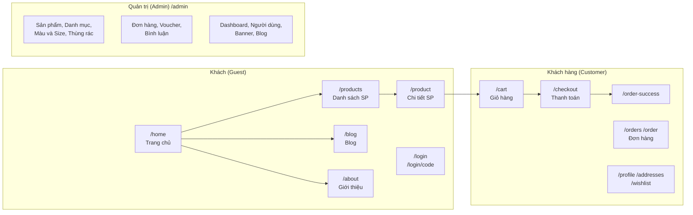
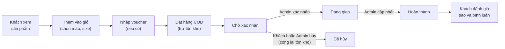

# Saltair: tóm tắt dự án trong một trang

Website bán quần áo thời trang **Saltair** (đồ basic phong cách biển, unisex). Đồ án môn Java 1, nhóm 6 người.
Java Servlet/JSP thuần, MySQL, chạy trên Tomcat 11. Chi tiết đầy đủ nằm ở `project.md`; file này chỉ giúp bạn hình dung nhanh.

## 1. Ba loại người dùng

| Vai trò | Là ai | Làm được gì |
|---|---|---|
| **Guest** | Chưa đăng nhập | Xem trang chủ, danh sách và chi tiết sản phẩm, blog. Đăng nhập hoặc tạo tài khoản bằng email + mã 6 số |
| **Customer** | Khách đã đăng nhập | Mọi thứ của Guest, thêm: giỏ hàng, yêu thích, sổ địa chỉ, đặt hàng COD, dùng voucher, xem và hủy đơn, đánh giá sản phẩm |
| **Admin** | Quản trị | Quản lý sản phẩm, danh mục, màu và size, đơn hàng, người dùng, banner, blog, voucher, bình luận, thống kê, thùng rác |

## 2. Các trang của website



## 3. Một đơn hàng đi qua những gì



Quy tắc nhớ nhanh: khách chỉ hủy được khi đơn **Chờ xác nhận**. Chỉ đơn **Hoàn thành** mới được đánh giá. Phí ship cố định 30.000đ, đơn dùng voucher hợp lệ thì miễn phí ship.

## 4. Code được tổ chức thế nào

Code chia theo **tầng** (`controller`, `service`, `dao`, `model`), mỗi tầng chia tiếp thư mục con theo chức năng (`auth`, `account`, `shop`, `cart`, `order`, `admin`). Ví dụ đăng nhập: `controller/auth/LoginServlet`, `service/auth/AuthService`, `dao/auth/UserDAO`.

```
Trình duyệt → Servlet → Service → DAO → MySQL
                 ↓
               JSP (chỉ hiển thị)
```

- **Servlet** nhận yêu cầu, gọi Service, chuyển dữ liệu sang JSP. Không viết SQL.
- **Service** chứa logic nghiệp vụ (kiểm tra voucher, trừ tồn kho, transaction).
- **DAO** chứa toàn bộ câu SQL, dùng `PreparedStatement`. Không có logic nghiệp vụ.
- **JSP** chỉ hiển thị, không gọi Service hay DAO.

## 5. Hiện đang ở đâu

- Mọi chức năng (giai đoạn 1 đến 3) đã chạy bằng dữ liệu thật trong MySQL. Package `mock` và `DevPreviewFilter` đã xóa, `demoMode = false`.
- Database có 17 bảng (`database/schema.sql`) và dữ liệu mẫu (`database/data.sql`).

## 6. Cách xem thử website

Chạy dự án rồi mở `http://localhost:8080/saltair/home`. Đăng nhập bằng tài khoản demo để xem theo vai trò khách hàng hoặc quản trị.

Tài khoản demo trong `data.sql` (đăng nhập bằng mã, bật `auth.devCode=true` trong `mail.properties` để thấy mã): `admin@saltair.vn`, `khach@saltair.vn`.
