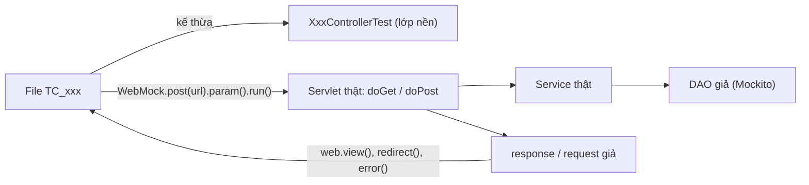

# Tổ chức mã test controller

```text
controllers/
├── support/                      # dùng chung
│   ├── WebMock.java              # request/response/session giả; run(servlet) gọi vào controller
│   └── Fixtures.java             # người dùng, đồ uống, hóa đơn mẫu
├── auth/                         # Đăng nhập và tài khoản
│   ├── AuthControllerTest.java   # lớp nền: dựng đối tượng được test
│   └── TC_AUTH_001 ... TC_AUTH_016   # mỗi Test Case ID một file
├── security/                     # Phân quyền
│   ├── SecurityControllerTest.java # lớp nền: dựng đối tượng được test
│   └── TC_SEC_001 ... TC_SEC_004   # mỗi Test Case ID một file
├── home/                         # Trang chủ
│   ├── HomeControllerTest.java   # lớp nền: dựng đối tượng được test
│   └── TC_HOME_001 ... TC_HOME_002   # mỗi Test Case ID một file
├── category/                     # Loại đồ uống
│   ├── CategoryControllerTest.java # lớp nền: dựng đối tượng được test
│   └── TC_CAT_001 ... TC_CAT_008   # mỗi Test Case ID một file
├── drink/                        # Đồ uống
│   ├── DrinkControllerTest.java  # lớp nền: dựng đối tượng được test
│   └── TC_DRINK_001 ... TC_DRINK_011   # mỗi Test Case ID một file
├── staff/                        # Nhân viên
│   ├── StaffControllerTest.java  # lớp nền: dựng đối tượng được test
│   └── TC_STAFF_001 ... TC_STAFF_011   # mỗi Test Case ID một file
├── pos/                          # Bán hàng POS
│   ├── PosControllerTest.java    # lớp nền: dựng đối tượng được test
│   └── TC_POS_001 ... TC_POS_012   # mỗi Test Case ID một file
├── bill/                         # Hóa đơn
│   ├── BillControllerTest.java   # lớp nền: dựng đối tượng được test
│   └── TC_BILL_001 ... TC_BILL_011   # mỗi Test Case ID một file
└── stats/                        # Thống kê
    ├── StatsControllerTest.java  # lớp nền: dựng đối tượng được test
    └── TC_STATS_001 ... TC_STATS_006   # mỗi Test Case ID một file
```

Tên package test trùng tên package controller trong `src/main/java/com/polycoffee/controller/` (riêng `security` test `filter/AuthFilter`).

## Luồng chạy của một test



Ví dụ với `TC_AUTH_001`:

1. `TC_AUTH_001_LoginSuccessControllerTest` gọi `WebMock.post("/auth/login")...run(authServlet)`.
2. `authServlet` được tạo trong `AuthControllerTest`.
3. `run` gọi `servlet.service(...)`, từ đó vào `AuthServlet.doPost`.
4. `doPost` gọi `AuthService.login`, rồi `UserDAO.findByEmail` (giả).
5. Test kiểm tra session và địa chỉ redirect.

## Tra nhanh: ID nằm ở file nào, gọi vào đâu

### Đăng nhập và tài khoản (`auth/`)

| ID | File | Request | Gọi vào |
|---|---|---|---|
| TC_AUTH_001 | [TC_AUTH_001_LoginSuccessControllerTest](auth/TC_AUTH_001_LoginSuccessControllerTest.java) | POST /auth/login | `AuthServlet.doPost` → AuthService.login |
| TC_AUTH_002 | [TC_AUTH_002_LoginReturnUrlControllerTest](auth/TC_AUTH_002_LoginReturnUrlControllerTest.java) | POST /auth/login | `AuthServlet.doPost` → AuthService.login |
| TC_AUTH_003 | [TC_AUTH_003_LoginWrongPasswordControllerTest](auth/TC_AUTH_003_LoginWrongPasswordControllerTest.java) | POST /auth/login | `AuthServlet.doPost` → AuthService.login |
| TC_AUTH_004 | [TC_AUTH_004_LoginUnknownEmailControllerTest](auth/TC_AUTH_004_LoginUnknownEmailControllerTest.java) | POST /auth/login | `AuthServlet.doPost` → AuthService.login |
| TC_AUTH_005 | [TC_AUTH_005_LoginLockedAccountControllerTest](auth/TC_AUTH_005_LoginLockedAccountControllerTest.java) | POST /auth/login | `AuthServlet.doPost` → AuthService.login |
| TC_AUTH_006 | [TC_AUTH_006_LoginInputValidationControllerTest](auth/TC_AUTH_006_LoginInputValidationControllerTest.java) | POST /auth/login | `AuthServlet.doPost` → AuthService.login |
| TC_AUTH_007 | [TC_AUTH_007_LogoutControllerTest](auth/TC_AUTH_007_LogoutControllerTest.java) | POST /auth/logout | `AuthServlet.doPost` → (AuthUtil.clear) |
| TC_AUTH_008 | [TC_AUTH_008_LogoutByGetControllerTest](auth/TC_AUTH_008_LogoutByGetControllerTest.java) | GET /auth/logout | `AuthServlet.doGet` → (không gọi) |
| TC_AUTH_009 | [TC_AUTH_009_ChangePasswordSuccessControllerTest](auth/TC_AUTH_009_ChangePasswordSuccessControllerTest.java) | POST /account/password | `AccountServlet.doPost` → AuthService.changePassword |
| TC_AUTH_010 | [TC_AUTH_010_ChangePasswordBoundaryControllerTest](auth/TC_AUTH_010_ChangePasswordBoundaryControllerTest.java) | POST /account/password | `AccountServlet.doPost` → AuthService.changePassword |
| TC_AUTH_011 | [TC_AUTH_011_ChangePasswordWrongOldControllerTest](auth/TC_AUTH_011_ChangePasswordWrongOldControllerTest.java) | POST /account/password | `AccountServlet.doPost` → AuthService.changePassword |
| TC_AUTH_012 | [TC_AUTH_012_ForgotPasswordSuccessControllerTest](auth/TC_AUTH_012_ForgotPasswordSuccessControllerTest.java) | POST /auth/forgot-password | `ForgotPasswordServlet.doPost` → AuthService.forgotPassword -> PasswordReset.apply |
| TC_AUTH_013 | [TC_AUTH_013_ForgotPasswordUnknownEmailControllerTest](auth/TC_AUTH_013_ForgotPasswordUnknownEmailControllerTest.java) | POST /auth/forgot-password | `ForgotPasswordServlet.doPost` → AuthService.forgotPassword |
| TC_AUTH_014 | [TC_AUTH_014_ForgotPasswordMailFailsControllerTest](auth/TC_AUTH_014_ForgotPasswordMailFailsControllerTest.java) | POST /auth/forgot-password | `ForgotPasswordServlet.doPost` → AuthService.forgotPassword -> PasswordReset.apply |
| TC_AUTH_015 | [TC_AUTH_015_UpdateProfileControllerTest](auth/TC_AUTH_015_UpdateProfileControllerTest.java) | POST /account/profile | `AccountServlet.doPost` → AuthService.updateProfile |
| TC_AUTH_016 | [TC_AUTH_016_LoginTimeoutControllerTest](auth/TC_AUTH_016_LoginTimeoutControllerTest.java) | POST /auth/login | `AuthServlet.doPost` → AuthService.login |

### Phân quyền (`security/`)

| ID | File | Request | Gọi vào |
|---|---|---|---|
| TC_SEC_001 | [TC_SEC_001_AnonymousRedirectControllerTest](security/TC_SEC_001_AnonymousRedirectControllerTest.java) | GET /manager/drinks?page=2 | `AuthFilter.doFilter` → (không có service) |
| TC_SEC_002 | [TC_SEC_002_StaffBlockedFromManagerControllerTest](security/TC_SEC_002_StaffBlockedFromManagerControllerTest.java) | GET /manager/* | `AuthFilter.doFilter` → (không có service) |
| TC_SEC_003 | [TC_SEC_003_AllowedRequestsControllerTest](security/TC_SEC_003_AllowedRequestsControllerTest.java) | GET /manager/*, /employee/*, /account/* | `AuthFilter.doFilter` → (không có service) |
| TC_SEC_004 | [TC_SEC_004_AnonymousPostControllerTest](security/TC_SEC_004_AnonymousPostControllerTest.java) | POST /employee/pos/checkout | `AuthFilter.doFilter` → (không có service) |

### Trang chủ (`home/`)

| ID | File | Request | Gọi vào |
|---|---|---|---|
| TC_HOME_001 | [TC_HOME_001_ShowActiveDrinksControllerTest](home/TC_HOME_001_ShowActiveDrinksControllerTest.java) | GET /home | `HomeServlet.doGet` → DrinkService.findActive |
| TC_HOME_002 | [TC_HOME_002_CategoryFilterInputControllerTest](home/TC_HOME_002_CategoryFilterInputControllerTest.java) | GET /home?categoryId= | `HomeServlet.doGet` → DrinkService.findActive |

### Loại đồ uống (`category/`)

| ID | File | Request | Gọi vào |
|---|---|---|---|
| TC_CAT_001 | [TC_CAT_001_ListCategoriesControllerTest](category/TC_CAT_001_ListCategoriesControllerTest.java) | GET /manager/categories | `CategoryServlet.doGet` → CategoryService.findAll |
| TC_CAT_002 | [TC_CAT_002_CreateCategoryControllerTest](category/TC_CAT_002_CreateCategoryControllerTest.java) | POST /manager/categories/create | `CategoryServlet.doPost` → CategoryService.create |
| TC_CAT_003 | [TC_CAT_003_NameBoundaryControllerTest](category/TC_CAT_003_NameBoundaryControllerTest.java) | POST /manager/categories/create | `CategoryServlet.doPost` → CategoryService.create |
| TC_CAT_004 | [TC_CAT_004_DuplicateNameControllerTest](category/TC_CAT_004_DuplicateNameControllerTest.java) | POST /manager/categories/create | `CategoryServlet.doPost` → CategoryService.create |
| TC_CAT_005 | [TC_CAT_005_UpdateKeepsOwnNameControllerTest](category/TC_CAT_005_UpdateKeepsOwnNameControllerTest.java) | POST /manager/categories/update | `CategoryServlet.doPost` → CategoryService.update |
| TC_CAT_006 | [TC_CAT_006_DeleteEmptyCategoryControllerTest](category/TC_CAT_006_DeleteEmptyCategoryControllerTest.java) | POST /manager/categories/delete | `CategoryServlet.doPost` → CategoryService.delete |
| TC_CAT_007 | [TC_CAT_007_DeleteUsedCategoryControllerTest](category/TC_CAT_007_DeleteUsedCategoryControllerTest.java) | POST /manager/categories/delete | `CategoryServlet.doPost` → CategoryService.delete |
| TC_CAT_008 | [TC_CAT_008_EditMissingCategoryControllerTest](category/TC_CAT_008_EditMissingCategoryControllerTest.java) | GET /manager/categories?editId=999 | `CategoryServlet.doGet` → CategoryService.findById |

### Đồ uống (`drink/`)

| ID | File | Request | Gọi vào |
|---|---|---|---|
| TC_DRINK_001 | [TC_DRINK_001_SearchWithFiltersControllerTest](drink/TC_DRINK_001_SearchWithFiltersControllerTest.java) | GET /manager/drinks | `DrinkServlet.doGet` → DrinkService.search |
| TC_DRINK_002 | [TC_DRINK_002_PagingBoundaryControllerTest](drink/TC_DRINK_002_PagingBoundaryControllerTest.java) | GET /manager/drinks?page= | `DrinkServlet.doGet` → DrinkService.search |
| TC_DRINK_003 | [TC_DRINK_003_CreateDrinkControllerTest](drink/TC_DRINK_003_CreateDrinkControllerTest.java) | POST /manager/drinks/create | `DrinkServlet.doPost` → DrinkService.save |
| TC_DRINK_004 | [TC_DRINK_004_PriceBoundaryControllerTest](drink/TC_DRINK_004_PriceBoundaryControllerTest.java) | POST /manager/drinks/create | `DrinkServlet.doPost` → DrinkService.save |
| TC_DRINK_005 | [TC_DRINK_005_NameBoundaryControllerTest](drink/TC_DRINK_005_NameBoundaryControllerTest.java) | POST /manager/drinks/create | `DrinkServlet.doPost` → DrinkService.save |
| TC_DRINK_006 | [TC_DRINK_006_MissingCategoryControllerTest](drink/TC_DRINK_006_MissingCategoryControllerTest.java) | POST /manager/drinks/create | `DrinkServlet.doPost` → DrinkService.save |
| TC_DRINK_007 | [TC_DRINK_007_DuplicateNameControllerTest](drink/TC_DRINK_007_DuplicateNameControllerTest.java) | POST /manager/drinks/create | `DrinkServlet.doPost` → DrinkService.save |
| TC_DRINK_008 | [TC_DRINK_008_DeleteNeverSoldControllerTest](drink/TC_DRINK_008_DeleteNeverSoldControllerTest.java) | POST /manager/drinks/delete | `DrinkServlet.doPost` → DrinkService.delete |
| TC_DRINK_009 | [TC_DRINK_009_DeleteSoldDrinkControllerTest](drink/TC_DRINK_009_DeleteSoldDrinkControllerTest.java) | POST /manager/drinks/delete | `DrinkServlet.doPost` → DrinkService.delete |
| TC_DRINK_010 | [TC_DRINK_010_UpdateKeepsImageControllerTest](drink/TC_DRINK_010_UpdateKeepsImageControllerTest.java) | POST /manager/drinks/update | `DrinkServlet.doPost` → DrinkService.findById, save |
| TC_DRINK_011 | [TC_DRINK_011_DescriptionBoundaryControllerTest](drink/TC_DRINK_011_DescriptionBoundaryControllerTest.java) | POST /manager/drinks/create | `DrinkServlet.doPost` → DrinkService.save |

### Nhân viên (`staff/`)

| ID | File | Request | Gọi vào |
|---|---|---|---|
| TC_STAFF_001 | [TC_STAFF_001_SearchByStatusControllerTest](staff/TC_STAFF_001_SearchByStatusControllerTest.java) | GET /manager/staff | `StaffServlet.doGet` → StaffService.search |
| TC_STAFF_002 | [TC_STAFF_002_CreateStaffControllerTest](staff/TC_STAFF_002_CreateStaffControllerTest.java) | POST /manager/staff/create | `StaffServlet.doPost` → StaffService.create |
| TC_STAFF_003 | [TC_STAFF_003_PhoneValidationControllerTest](staff/TC_STAFF_003_PhoneValidationControllerTest.java) | POST /manager/staff/create | `StaffServlet.doPost` → StaffService.create |
| TC_STAFF_004 | [TC_STAFF_004_EmailValidationControllerTest](staff/TC_STAFF_004_EmailValidationControllerTest.java) | POST /manager/staff/create | `StaffServlet.doPost` → StaffService.create |
| TC_STAFF_005 | [TC_STAFF_005_DuplicateEmailControllerTest](staff/TC_STAFF_005_DuplicateEmailControllerTest.java) | POST /manager/staff/create | `StaffServlet.doPost` → StaffService.create |
| TC_STAFF_006 | [TC_STAFF_006_LockAccountControllerTest](staff/TC_STAFF_006_LockAccountControllerTest.java) | POST /manager/staff/status | `StaffServlet.doPost` → StaffService.setActive |
| TC_STAFF_007 | [TC_STAFF_007_CannotEditManagerControllerTest](staff/TC_STAFF_007_CannotEditManagerControllerTest.java) | POST /manager/staff/status | `StaffServlet.doPost` → StaffService.findStaff |
| TC_STAFF_008 | [TC_STAFF_008_ResetPasswordControllerTest](staff/TC_STAFF_008_ResetPasswordControllerTest.java) | POST /manager/staff/reset-password | `StaffServlet.doPost` → StaffService.resetPassword -> PasswordReset.apply |
| TC_STAFF_009 | [TC_STAFF_009_ResetPasswordMailFailsControllerTest](staff/TC_STAFF_009_ResetPasswordMailFailsControllerTest.java) | POST /manager/staff/reset-password | `StaffServlet.doPost` → StaffService.resetPassword -> PasswordReset.apply |
| TC_STAFF_010 | [TC_STAFF_010_RoleInjectionControllerTest](staff/TC_STAFF_010_RoleInjectionControllerTest.java) | POST /manager/staff/create | `StaffServlet.doPost` → StaffService.create |
| TC_STAFF_011 | [TC_STAFF_011_PasswordBoundaryControllerTest](staff/TC_STAFF_011_PasswordBoundaryControllerTest.java) | POST /manager/staff/create | `StaffServlet.doPost` → StaffService.create |

### Bán hàng POS (`pos/`)

| ID | File | Request | Gọi vào |
|---|---|---|---|
| TC_POS_001 | [TC_POS_001_OpenBillControllerTest](pos/TC_POS_001_OpenBillControllerTest.java) | POST /employee/pos/init | `PosServlet.doPost` → PosService.addDrink |
| TC_POS_002 | [TC_POS_002_AddExistingDrinkControllerTest](pos/TC_POS_002_AddExistingDrinkControllerTest.java) | POST /employee/pos/init | `PosServlet.doPost` → PosService.addDrink |
| TC_POS_003 | [TC_POS_003_AddNewDrinkControllerTest](pos/TC_POS_003_AddNewDrinkControllerTest.java) | POST /employee/pos/init | `PosServlet.doPost` → PosService.addDrink |
| TC_POS_004 | [TC_POS_004_InactiveDrinkControllerTest](pos/TC_POS_004_InactiveDrinkControllerTest.java) | POST /employee/pos/init | `PosServlet.doPost` → PosService.addDrink |
| TC_POS_005 | [TC_POS_005_QuantityActionsControllerTest](pos/TC_POS_005_QuantityActionsControllerTest.java) | POST /employee/pos/update-quantity | `PosServlet.doPost` → PosService.changeQuantity |
| TC_POS_006 | [TC_POS_006_QuantityOverLimitControllerTest](pos/TC_POS_006_QuantityOverLimitControllerTest.java) | POST /employee/pos/update-quantity | `PosServlet.doPost` → PosService.changeQuantity |
| TC_POS_007 | [TC_POS_007_ClosedBillImmutableControllerTest](pos/TC_POS_007_ClosedBillImmutableControllerTest.java) | POST /employee/pos/update-quantity, checkout, cancel | `PosServlet.doPost` → PosService.changeQuantity, checkout, cancel |
| TC_POS_008 | [TC_POS_008_OtherStaffBillControllerTest](pos/TC_POS_008_OtherStaffBillControllerTest.java) | POST /employee/pos/checkout | `PosServlet.doPost` → PosService.checkout -> BillService.findAccessible |
| TC_POS_009 | [TC_POS_009_CheckoutControllerTest](pos/TC_POS_009_CheckoutControllerTest.java) | POST /employee/pos/checkout | `PosServlet.doPost` → PosService.checkout -> BillService.changeStatus |
| TC_POS_010 | [TC_POS_010_CheckoutEmptyBillControllerTest](pos/TC_POS_010_CheckoutEmptyBillControllerTest.java) | POST /employee/pos/checkout | `PosServlet.doPost` → PosService.checkout |
| TC_POS_011 | [TC_POS_011_CancelWaitingBillControllerTest](pos/TC_POS_011_CancelWaitingBillControllerTest.java) | POST /employee/pos/cancel | `PosServlet.doPost` → PosService.cancel -> BillService.changeStatus |
| TC_POS_012 | [TC_POS_012_InvalidActionControllerTest](pos/TC_POS_012_InvalidActionControllerTest.java) | POST /employee/pos/update-quantity; GET /employee/pos/checkout | `PosServlet.doPost` → PosService.changeQuantity |

### Hóa đơn (`bill/`)

| ID | File | Request | Gọi vào |
|---|---|---|---|
| TC_BILL_001 | [TC_BILL_001_TransitionMatrixControllerTest](bill/TC_BILL_001_TransitionMatrixControllerTest.java) | Gọi thẳng service (hàm thuần) | `BillService.canTransition` → BillService.canTransition |
| TC_BILL_002 | [TC_BILL_002_ManagerCancelsPaidBillControllerTest](bill/TC_BILL_002_ManagerCancelsPaidBillControllerTest.java) | POST /manager/bills/cancel | `BillManageServlet.doPost` → BillService.changeStatus |
| TC_BILL_003 | [TC_BILL_003_StaffCannotCancelPaidBillControllerTest](bill/TC_BILL_003_StaffCannotCancelPaidBillControllerTest.java) | POST /manager/bills/cancel (giả sử lọt qua filter) | `BillManageServlet.doPost` → BillService.changeStatus |
| TC_BILL_004 | [TC_BILL_004_CancelTwiceControllerTest](bill/TC_BILL_004_CancelTwiceControllerTest.java) | POST /manager/bills/cancel | `BillManageServlet.doPost` → BillService.changeStatus |
| TC_BILL_005 | [TC_BILL_005_ConcurrentUpdateControllerTest](bill/TC_BILL_005_ConcurrentUpdateControllerTest.java) | POST /manager/bills/cancel | `BillManageServlet.doPost` → BillService.changeStatus |
| TC_BILL_006 | [TC_BILL_006_StaffSeesOwnBillsControllerTest](bill/TC_BILL_006_StaffSeesOwnBillsControllerTest.java) | GET /employee/bills | `EmployeeBillServlet.doGet` → BillService.search |
| TC_BILL_007 | [TC_BILL_007_ManagerListsAllControllerTest](bill/TC_BILL_007_ManagerListsAllControllerTest.java) | GET /manager/bills | `BillManageServlet.doGet` → BillService.search |
| TC_BILL_008 | [TC_BILL_008_InvalidDateRangeControllerTest](bill/TC_BILL_008_InvalidDateRangeControllerTest.java) | GET /manager/bills | `BillManageServlet.doGet` → Validator.optionalDate, BillService.search |
| TC_BILL_009 | [TC_BILL_009_ViewOthersBillControllerTest](bill/TC_BILL_009_ViewOthersBillControllerTest.java) | GET /employee/bills/detail | `EmployeeBillServlet.doGet` → BillService.findAccessible |
| TC_BILL_010 | [TC_BILL_010_BillNotFoundControllerTest](bill/TC_BILL_010_BillNotFoundControllerTest.java) | GET /manager/bills/detail | `BillManageServlet.doGet` → BillService.findAccessible |
| TC_BILL_011 | [TC_BILL_011_ViewDetailControllerTest](bill/TC_BILL_011_ViewDetailControllerTest.java) | GET /manager/bills/detail | `BillManageServlet.doGet` → BillService.findAccessible, details |

### Thống kê (`stats/`)

| ID | File | Request | Gọi vào |
|---|---|---|---|
| TC_STATS_001 | [TC_STATS_001_TopDrinksControllerTest](stats/TC_STATS_001_TopDrinksControllerTest.java) | GET /manager/stats/top-drinks | `StatsServlet.doGet` → StatisticService.topDrinks |
| TC_STATS_002 | [TC_STATS_002_RevenueTotalsControllerTest](stats/TC_STATS_002_RevenueTotalsControllerTest.java) | GET /manager/stats/revenue | `StatsServlet.doGet` → StatisticService.revenue |
| TC_STATS_003 | [TC_STATS_003_InvalidRangeControllerTest](stats/TC_STATS_003_InvalidRangeControllerTest.java) | GET /manager/stats/revenue | `StatsServlet.doGet` → StatisticService.revenue |
| TC_STATS_004 | [TC_STATS_004_SameDayRangeControllerTest](stats/TC_STATS_004_SameDayRangeControllerTest.java) | GET /manager/stats/revenue | `StatsServlet.doGet` → StatisticService.revenue |
| TC_STATS_005 | [TC_STATS_005_NoDataControllerTest](stats/TC_STATS_005_NoDataControllerTest.java) | GET /manager/stats/revenue | `StatsServlet.doGet` → StatisticService.revenue |
| TC_STATS_006 | [TC_STATS_006_LargeDataTimeoutControllerTest](stats/TC_STATS_006_LargeDataTimeoutControllerTest.java) | GET /manager/stats/revenue | `StatsServlet.doGet` → StatisticService.revenue |

## Chạy

```bash
mvn test -Dtest='TC_POS_005_*'   # một ID
mvn test -Dgroups=TC_POS_005      # cùng ID, theo @Tag
mvn test -Dtest='TC_POS_*'        # cả nhóm
mvn test -Dtest='*ControllerTest' # tất cả
```
